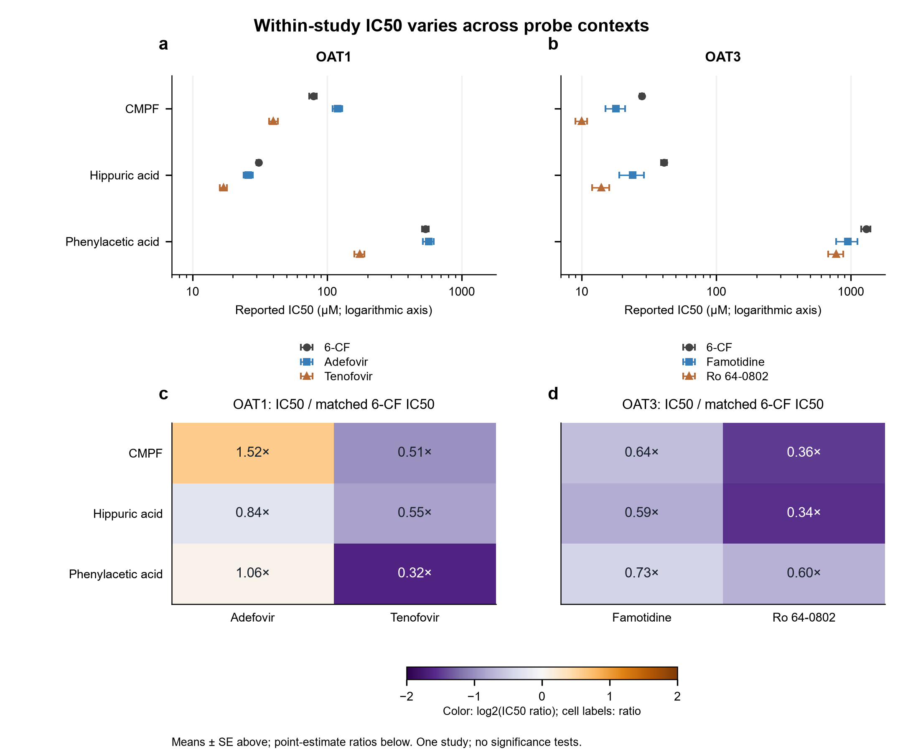
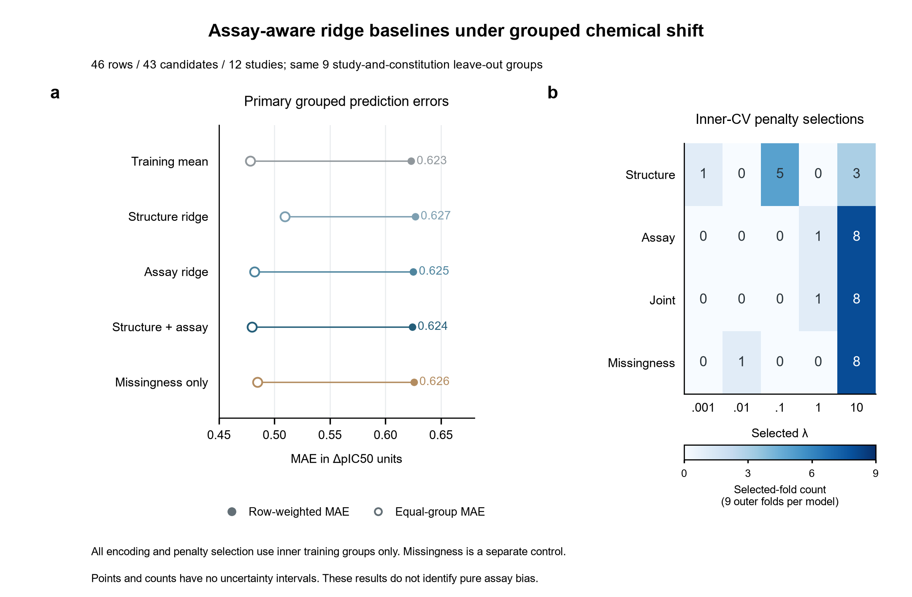
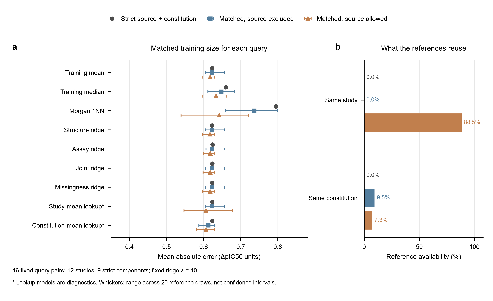
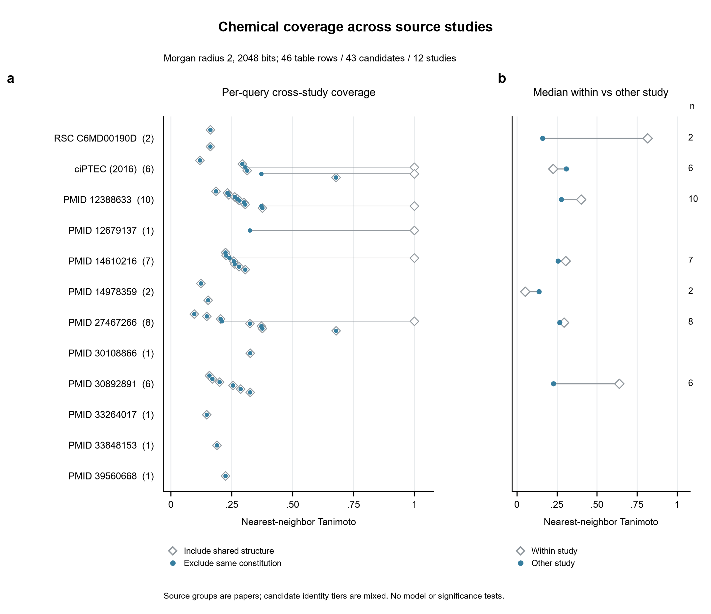
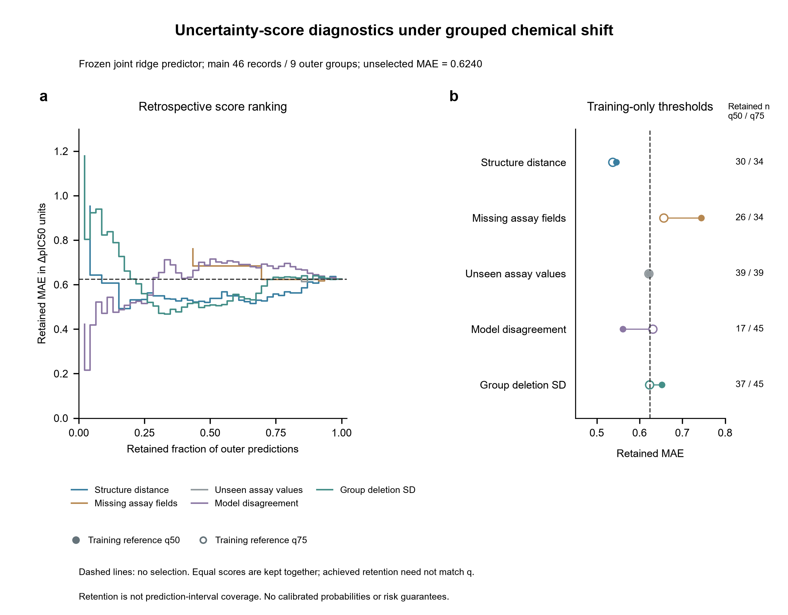
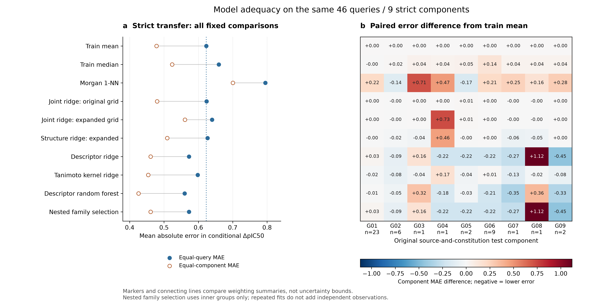
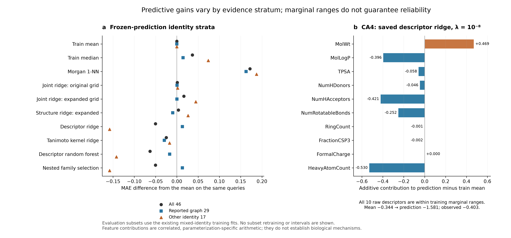
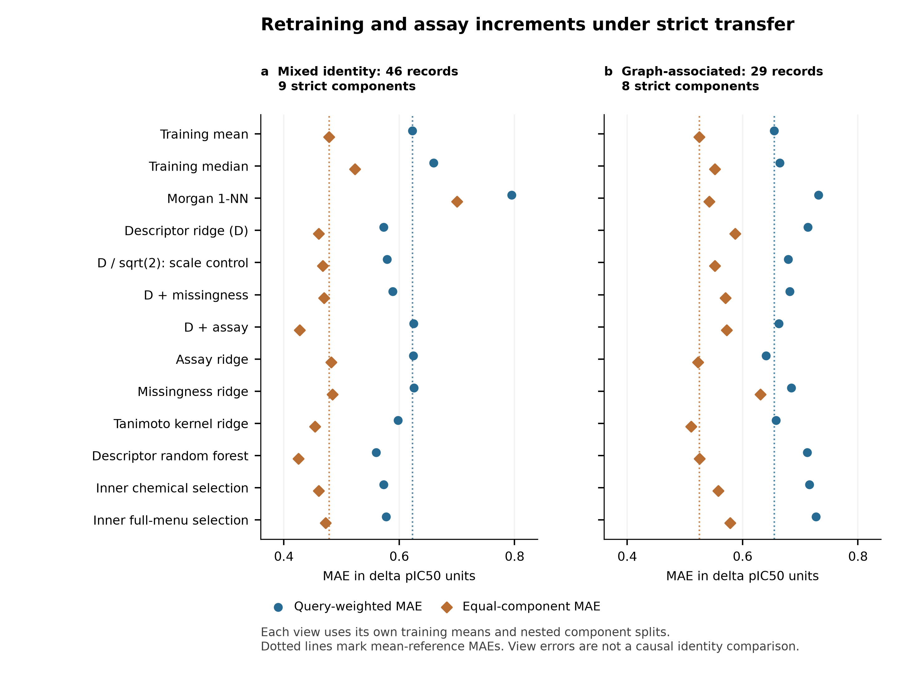
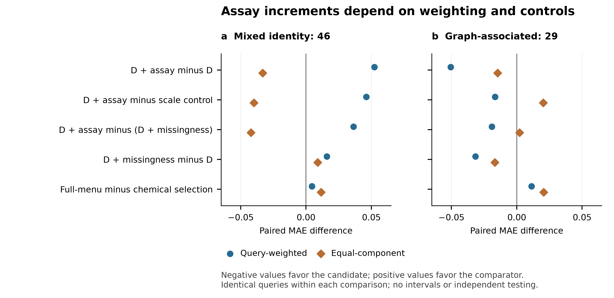

# Tables and figures / 表格与图注

Historical assets retain their original numerical values and stage-specific definitions. Tables S7–S8 and Figures6/S3 add the fixed v0.26 retraining and assay comparisons; earlier tables are not alternative estimates of the same fit.

## Table 1. Evidence and analysis layers

Layers overlap or are maintained independently; their counts are not additive. Physical reagent identity is not certified by candidate graph association.

| Layer | Rows | Papers | Qualification |
| --- | ---: | ---: | --- |
|FROZEN_SOURCE_LEDGER|90|—|Numeric/endpoint/provenance partition, not independent training examples|
|ORDINARY_EXPLICIT_IC50|51|—|Endpoint/numeric count; structure and assay qualification evaluated separately|
|EXACT_KI_SEPARATE|18|—|Never pooled as IC50|
|MAIN_EXPLORATORY|46|12|Mixed identity tiers;43candidate constitutions;9joint groups|
|REPORTED_GRAPH_SUBSET|29|8|Reported representation, not certified physical reagent|
|SAME_NOMINAL_PROBE_SUBSET|6|1|Same nominal probe only; no multisource generalization set|
|ORDINARY_POINT_SENSITIVITY|48|13|Separate48-row view, including2added library pairs|
|APPARENT_FIT_FAMILY_SENSITIVITY|54|14|Separate54-row sensitivity, includes6apparent R/S pairs; not added to90|

## Table 2A. Strict nested evaluation

The same 46 queries in nine source-and-constitution groups; λ selected within each outer training set. Query-weighted MAE in ΔpIC50 units.

| Model | MAE |
| --- | ---: |
|TRAIN_MEAN|0.623067|
|TRAIN_MEDIAN|0.659646|
|MORGAN_1NN_TIE_MEAN|0.794936|
|STRUCTURE_RIDGE|0.626681|
|ASSAY_RIDGE|0.625074|
|STRUCTURE_ASSAY_RIDGE|0.624007|
|MISSINGNESS_RIDGE|0.625517|

## Table 2B. Fixed-λ10 matched-reference diagnostic

The training size is fixed for each query. Each sampled arm has 20 draws. Errors are first averaged per query and then across queries. Lookups fall back to the training mean for unseen keys. This is not random K-fold evaluation; draws do not increase independent sample size.

| Model | Strict | Matched, exclude source | Matched, allow source |
| --- | ---: | ---: | ---: |
|TRAIN_MEAN|0.623067|0.622777|0.617542|
|TRAIN_MEDIAN|0.659646|0.647827|0.633510|
|MORGAN_1NN_TIE_MEAN|0.794936|0.736500|0.641774|
|STRUCTURE_RIDGE|0.622985|0.622790|0.617223|
|ASSAY_RIDGE|0.623882|0.623001|0.617877|
|STRUCTURE_ASSAY_RIDGE|0.623439|0.622846|0.617550|
|MISSINGNESS_RIDGE|0.623225|0.622923|0.617543|
|SEEN_STUDY_MEAN_FALLBACK_GLOBAL|0.623067|0.622777|0.606257|
|SEEN_CONSTITUTION_MEAN_FALLBACK_GLOBAL|0.623067|0.612552|0.606570|

Tables 2A and 2B use different tuning rules: 0.624007 and 0.623439 are not duplicate versions of the same fitted model.

## Table S1. Input-view and chirality sensitivity

| View | Fingerprint | Queries | Mean MAE | Joint MAE |
| --- | --- | ---: | ---: | ---: |
|FROZEN46_CONTROL|NONCHIRAL|46|0.623067|0.624007|
|FROZEN46_CONTROL|CHIRAL|46|0.623067|0.624735|
|READY48_ORDINARY_POINT|NONCHIRAL|48|0.617807|0.622766|
|READY48_ORDINARY_POINT|CHIRAL|48|0.617807|0.622833|
|READY54_APPARENT_FAMILY_SENSITIVITY|NONCHIRAL|54|0.602435|0.603874|
|READY54_APPARENT_FAMILY_SENSITIVITY|CHIRAL|54|0.602435|0.603867|

The 48- and 54-row views contain 13 and 14 papers. The 54-row view retains apparent-fit semantics. Errors across views also reflect different queries, groups and target definitions.

## Table S2. Frozen-ledger publication sources

These 22 keys index the 90-row ledger, not 22 eligible modeling studies. Row-level dispositions remain controlling. R10 and R11 contribute only to later sensitivity inputs and are not added to this ledger.

| Source/reference | Ledger rows | Main46 rows | Dispositions |
| --- | ---: | ---: | --- |
|[13: doi:10.1039/c6md00190d](https://doi.org/10.1039/c6md00190d)|2|2|ORDINARY_EXACT_IC50|
|[12: doi:10.1039/c6md00191b](https://doi.org/10.1039/c6md00191b)|2|0|EXACT_INFERRED_ENDPOINT|
|[3: doi:10.1208/s12248-016-9871-8](https://doi.org/10.1208/s12248-016-9871-8)|7|6|APPARENT_IC50_PARTIAL_INHIBITION|ORDINARY_EXACT_IC50|
|[14: pmid:11426832](https://doi.org/10.1016/s0014-2999(01)00962-1)|4|0|EXACT_KI|
|[15: pmid:11669456](https://doi.org/10.1016/s0024-3205(01)01296-6)|5|0|EXACT_KI|
|[16: pmid:11909604](https://doi.org/10.1016/s0014-2999(02)01306-7)|8|0|EXACT_KI|
|[1: pmid:12388633](https://doi.org/10.1124/jpet.102.037580)|12|10|CENSORED_EXPLICIT_SINGLE_TARGET|ORDINARY_EXACT_IC50|
|[17: pmid:12679137](https://doi.org/10.1016/s0014-2999(03)01530-9)|2|1|EXACT_KI|ORDINARY_EXACT_IC50|
|[18: pmid:14610216](https://doi.org/10.1124/jpet.103.059139)|9|7|ORDINARY_EXACT_IC50|
|[19: pmid:14978359](https://doi.org/10.1254/jphs.94.197)|5|2|ORDINARY_EXACT_IC50|REPRINTED_NOT_INDEPENDENT|
|[20: pmid:20356304](https://doi.org/10.1021/jm901688m)|1|0|EXCLUDED_BY_USER_SECONDARY|
|[2: pmid:27467266](https://doi.org/10.1021/acs.molpharmaceut.6b00332)|15|8|INCOMPLETE_PAIR|ORDINARY_EXACT_IC50|
|[21: pmid:30108866](https://doi.org/10.1039/c7md00246g)|2|1|CENSORED_EXPLICIT_ENDPOINT|ORDINARY_EXACT_IC50|
|[22: pmid:30892891](https://doi.org/10.1021/acs.jnatprod.8b00888)|8|6|INCOMPLETE_PAIR|ORDINARY_EXACT_IC50|
|[23: pmid:32809824](https://doi.org/10.1021/acs.jmedchem.0c00640)|1|0|CENSORED_EXPLICIT_ENDPOINT|
|[24: pmid:33264017](https://doi.org/10.1021/acs.jmedchem.0c01346)|1|1|ORDINARY_EXACT_IC50|
|[25: pmid:33848153](https://doi.org/10.1021/acs.jmedchem.1c00124)|1|1|ORDINARY_EXACT_IC50|
|[26: pmid:35257579](https://doi.org/10.1021/acs.jmedchem.1c02131)|1|0|CENSORED_EXPLICIT_ENDPOINT|
|[27: pmid:35261239](https://doi.org/10.1021/acs.jmedchem.1c02132)|1|0|CENSORED_EXPLICIT_ENDPOINT|
|[28: pmid:38807539](https://doi.org/10.1021/acs.jmedchem.4c00893)|1|0|CENSORED_INFERRED_ENDPOINT|
|[29: pmid:39110625](https://doi.org/10.1021/acs.jmedchem.4c00360)|1|0|CENSORED_EXPLICIT_ENDPOINT|
|[30: pmid:39560668](https://doi.org/10.1021/acs.jmedchem.4c02230)|1|1|ORDINARY_EXACT_IC50|

## Numeric ledger partition

| Disposition | Source-table rows |
| --- | ---: |
|CENSORED_EXPLICIT_ENDPOINT|5|
|ORDINARY_EXACT_IC50|51|
|INCOMPLETE_PAIR|7|
|EXACT_INFERRED_ENDPOINT|2|
|CENSORED_INFERRED_ENDPOINT|1|
|EXCLUDED_BY_USER_SECONDARY|1|
|EXACT_KI|18|
|REPRINTED_NOT_INDEPENDENT|3|
|APPARENT_IC50_PARTIAL_INHIBITION|1|
|CENSORED_EXPLICIT_SINGLE_TARGET|1|

## Figure assets and legends

## Figure 1 — Probe contexts / 同研究探针条件

[PNG](figures/Figure1.png) · [SVG](figures/Figure1.svg).

**English legend.** Reported IC50 means ± SE for OAT1 and OAT3 are plotted on logarithmic concentration axes; lower panels show drug-probe estimates divided by the matched 6-CF estimate. The source Figure 4 reported 2–3 independent experiments with four determinations per concentration; repeated6-CF values came from Table 1, whose legend described 3–4 experiments in quadruplicate. Error bars reproduce reported SE; ratios are point estimates. 18 source entries represent 3 compounds, 2 targets and 3 probe contexts per target, including 6 redisplayed values. No significance tests or ratio intervals were calculated. Source: reference [2], Figure 4e/Table 1.

**中文图注。** 上方为原文IC50均值±SE，对数浓度轴；下方为药物探针与匹配6-CF估计值之比，按点估计显示。源Figure 4为2–3次独立实验、每浓度点四次测定；再展示的6-CF数值来自Table 1，其表注为3–4次实验、每次四复孔。18个来源表项包含6个再展示值，不是18次新实验。误差棒为原报SE；没有显著性检验或比值区间。

源数据：[source_data_18.csv](source_data/runs/probe_context_analysis_v1_20261029/derived/source_data_18.csv)、[12个比值](source_data/runs/probe_context_analysis_v1_20261029/derived/probe_to_6CF_ratios_12.csv)。

## Figure 2 — Strict model comparison / 严格模型比较

[PNG](figures/Figure2.png) · [SVG](figures/Figure2.svg).

**English legend.** Nested grouped evaluation of 46 pairs in 9 connected source-and-constitution groups. Filled points show record-weighted MAE; open points show equal-group MAE. Lines connect two weighting summaries, not uncertainty bounds. The right panel counts selected λ values in the 9 outer folds for each of four ridge models. Preprocessing and parameter selection use training records and inner groups only. The current figure concerns nested selection, not the separate fixed λ10 reference diagnostic. No error bars or calibrated intervals are shown.

**中文图注。** 共同46条配对、九个来源＋连接关系连通组。实心／空心点分别为按记录加权和按组等权MAE，连线连接两种权重汇总，不表示误差棒或不确定性界限。右侧为四种岭回归的九外折λ选择次数。预处理与选参仅使用训练侧及内层组；不与图3的固定λ诊断混写。

源数据：[36项模型指标](source_data/runs/assay_ridge_v1_20261030/derived/overall_metrics_36.csv)、[λ选择](source_data/runs/assay_ridge_v1_20261030/derived/lambda_selection.csv)。

## Figure 3 — Matched references / 匹配参考集

[PNG](figures/Figure3.png) · [SVG](figures/Figure3.svg).

**English legend.** All 9 predeclared models are compared using the same 46 queries and the same training-row count for each query across three reference designs. Four ridge models use fixed λ10. Sampled designs use 20 prespecified draws; points show average MAE and whiskers show the range of overall MAE across draws, not confidence intervals. Lookup models are diagnostics and fall back to the global training mean for unseen keys. Reference availability is the fraction of query–reference combinations with a same-source or same-candidate-constitution record. Repetitions share outcomes and do not increase independent sample size.

**中文图注。** 共同46条查询逐条匹配训练规模。两抽样臂各20轮，点为平均MAE，横线为各轮总体MAE最小—最大范围，非置信区间。岭回归固定λ10。查表方法仅作诊断，键不可见时退回训练均值。复用率按查询—参考集组合计算；同连接关系不等于认证同一实际试剂。

源数据：[27项指标](source_data/runs/reference_reuse_diagnostic_v1_20261031/derived/overall_metrics_27.csv)、[复用率](source_data/runs/reference_reuse_diagnostic_v1_20261031/derived/reference_reuse_summary_3.csv)、[图源数据](source_data/runs/reference_reuse_diagnostic_v1_20261031/figures/figure_source_data.csv)。

## Figure S1 — Chemical coverage / 化学覆盖

[PNG](figures/FigureS1.png) · [SVG](figures/FigureS1.svg).

Candidate chemistry coverage in 46 rows/43 constitutions/12 papers using fixed Morgan radius 2/2048-bit fingerprints. Comparisons including shared candidates and excluding the same constitution are distinct; panel b compares within-paper and other-paper nearest-neighbour summaries. Displayed source units are papers, not verified independent laboratories. Similarity bins are descriptive, not validated applicability cutoffs. No activity model or significance test is represented.

源数据：[nearest_neighbors_all_scenarios.csv](source_data/runs/chemical_shift_diagnostics_v1_20261030/derived/nearest_neighbors_all_scenarios.csv)。

**中文图注（图S1）。** 46条记录、43个候选连接关系、12篇论文的化学覆盖，采用固定半径2、2,048位Morgan指纹。保留相同候选与排除相同连接关系的比较分别显示；b面板比较同论文和其他论文近邻。论文不等于已验证独立实验室，相似度分箱不作为已验证适用域界限；本图不包含活性模型或显著性检验。

## Figure S2 — Retention diagnostics / 预测保留诊断

[PNG](figures/FigureS2.png) · [SVG](figures/FigureS2.svg).

The frozen nested joint predictor is evaluated using five uncertainty-score families. Retrospective rankings in panel a and training-reference threshold decisions in panel b serve different purposes. Filled/open points denote training-reference q50/q75 policies; lines connect policies, not confidence intervals. Equal-score queries are retained together, so retained fractions need not equal q. Reported retained-set model error must be compared with the training-mean predictor on the same retained records. Retention is not interval coverage; no calibrated probability or risk guarantee is shown.

源数据：[training_threshold_policy_results_270.csv](source_data/runs/uncertainty_diagnostics_v1_20261030/derived/training_threshold_policy_results_270.csv)、[回顾性曲线](source_data/runs/uncertainty_diagnostics_v1_20261030/derived/descriptive_risk_retention_curves.csv)。

**中文图注（图S2）。** 冻结嵌套联合预测器的五类分数。a面板为回顾排序，b面板为训练参考阈值决策；实心／空心点对应q50／q75，连线不表示区间。并列分数整块保留，实际保留比例可以不同于q。保留集合模型误差与相同记录的训练均值比较；保留比例不等于区间覆盖，本图不提供校准概率或风险保证。

中文核对：表1各层不可相加；表2A为嵌套选参，表2B为固定λ10；抽样范围非置信区间；表S2含被排除或未进入主模型的来源。

## Table S3. Locked model-adequacy comparison

All models use the same46queries/nine strict components. Each family is tuned within training groups; the last row chooses family/configuration by inner scores only. No confidence intervals or additional independent observations are implied.

| Model/procedure | Query MAE | Component MAE | Paper MAE | Better/worse components vs mean |
| --- | ---: | ---: | ---: | --- |
|TRAIN_MEAN|0.623067|0.478227|0.543339|0/0|
|TRAIN_MEDIAN|0.659646|0.523550|0.590301|1/8|
|MORGAN_1NN_TIE_MEAN|0.794936|0.700263|0.717813|2/7|
|JOINT_RIDGE_ORIGINAL_GRID_REPLAY|0.624007|0.479895|0.544601|3/6|
|JOINT_RIDGE_EXPANDED|0.639617|0.560798|0.605269|3/6|
|STRUCTURE_RIDGE_EXPANDED|0.626694|0.509295|0.566641|6/3|
|DESCRIPTOR_RIDGE|0.572801|0.460724|0.499826|6/3|
|TANIMOTO_KRR|0.598212|0.453813|0.524000|7/2|
|DESCRIPTOR_RF|0.559942|0.425579|0.469438|7/2|
|NESTED_FAMILY_SELECTION|0.572801|0.460724|0.499826|6/3|

## Table S4. Component-level errors
All90model/procedure–component results are provided in [fold_metrics_90.csv](derived/fold_metrics_90.csv). Components have unequal record counts and share training data; their error differences are descriptive.

## Figure4. Representation and model adequacy

The left panel shows equal-query and equal-component MAE for all10comparisons; connecting lines compare weighting summaries, not uncertainty. The right panel shows each component’s MAE difference from the training mean on the same queries; blue values indicate lower error. Rows have identical ordering in both panels. Family selection uses inner scores, and its coincidence with descriptor-ridge predictions reflects the nine inner choices rather than ten independent model discoveries.

图4：左侧为按查询／分量等权MAE，连线不是区间；右侧为同分量相对训练均值的MAE差。负值表示误差更低。两面板行序一致，保留全部比较与不利分量，不表示显著性或外部校准。

## Table S5. Frozen predictions by identity stratum

| Model/procedure | All46 | Report-associated graph29 | Other identity17 |
| --- | ---: | ---: | ---: |
|TRAIN_MEAN|0.623067|0.645907|0.584106|
|JOINT_RIDGE_ORIGINAL_GRID_REPLAY|0.624007|0.646287|0.586001|
|DESCRIPTOR_RIDGE|0.572801|0.658847|0.426016|
|TANIMOTO_KRR|0.598212|0.616516|0.566987|
|DESCRIPTOR_RF|0.559942|0.628994|0.442148|
|NESTED_FAMILY_SELECTION|0.572801|0.658847|0.426016|

All10families and all8fixed strata, including the empty nonzero-formal-charge stratum, appear in [stratum_metrics_80.csv](derived/stratum_metrics_80.csv). Each stratum uses identical query IDs for model and mean; the fits remain those trained on mixed-identity records. Rows are not added as new observations.

## Table S6. Scoring-unit and descriptor diagnostics

[Paper/component contributions](derived/scoring_unit_contributions_210.csv), [delete-scoring-unit summaries](derived/delete_scoring_unit_summaries_210.csv), [all46query descriptors](derived/descriptor_query_diagnostics_46.csv) and [all460feature contributions](derived/descriptor_feature_contributions_460.csv) retain complete results. Removing scoring rows is not deletion from training or a new fit.

## Figure5. Evidence-stratum dependence and a preserved failure

Panel a compares each family's model-minus-mean MAE on the same stratum query IDs. All families are shown. Panel b decomposes the saved CA4 descriptor-ridge prediction relative to its training mean. Its features are all inside marginal training ranges; the bars are arithmetic contributions from correlated descriptors, not independent effects, mechanistic importance or uncertainty intervals. No outcome-based case removal or correction was applied.

图5：a为相同查询子集的模型减均值MAE差；b为CA4保存模型的加性数值贡献。全部家族保留，特征均在单变量范围内不等于可靠预测，柱形不表示机制、独立作用或区间。

## Table S7. Fixed retraining and assay menu

| Model/procedure | Main46 query MAE | Main46 component MAE | Retrained29 query MAE | Retrained29 component MAE |
| --- | ---: | ---: | ---: | ---: |
|TRAIN_MEAN|0.623067|0.478227|0.654749|0.525142|
|TRAIN_MEDIAN|0.659646|0.523550|0.664709|0.551942|
|MORGAN_1NN_TIE_MEAN|0.794936|0.700263|0.731740|0.542405|
|DESCRIPTOR_RIDGE|0.572801|0.460724|0.713179|0.586915|
|DESCRIPTOR_HALF_BLOCK_RIDGE|0.579010|0.467297|0.679159|0.551954|
|DESCRIPTOR_MISSING_RIDGE|0.588756|0.469645|0.681594|0.570072|
|DESCRIPTOR_ASSAY_RIDGE|0.625067|0.427514|0.662607|0.572229|
|ASSAY_RIDGE_EXPANDED|0.624633|0.482074|0.640496|0.522512|
|MISSINGNESS_RIDGE_EXPANDED|0.625417|0.484235|0.684676|0.630963|
|TANIMOTO_KRR|0.598212|0.453813|0.657801|0.511034|
|DESCRIPTOR_RF|0.559942|0.425579|0.711848|0.525257|
|NESTED_CHEM_FAMILY|0.572801|0.460724|0.715729|0.557832|
|NESTED_ALL_FAMILY|0.577310|0.472246|0.727084|0.578413|

Each view uses its own nested source-and-constitution partitions and corresponding training means. The29view is retrained, unlike the previous29-query scoring subset. All13procedures are included; the lowest separate outer score is not a selector or an independently validated winner. [All metrics including equal-paper weights](derived/overall_metrics_26.csv), [component errors](derived/fold_metrics_221.csv), [paper errors](derived/paper_metrics_260.csv), [selected configurations](derived/selected_hyperparameters_187.csv) and [inner family choices](derived/selector_choices_34.csv) are retained.

## Table S8. All five paired comparisons in both views

Differences are candidate minus comparator; negative favors candidate. The estimands use identical query IDs within each comparison.

| View | Comparison | Query MAE difference | Component difference | Paper difference |
| --- | --- | ---: | ---: | ---: |
|46|DESCRIPTOR_ASSAY_RIDGE minus DESCRIPTOR_RIDGE|+0.052266|-0.033209|+0.009175|
|46|DESCRIPTOR_ASSAY_RIDGE minus DESCRIPTOR_HALF_BLOCK_RIDGE|+0.046057|-0.039782|-0.001881|
|46|DESCRIPTOR_ASSAY_RIDGE minus DESCRIPTOR_MISSING_RIDGE|+0.036311|-0.042131|-0.004272|
|46|DESCRIPTOR_MISSING_RIDGE minus DESCRIPTOR_RIDGE|+0.015955|+0.008921|+0.013447|
|46|NESTED_ALL_FAMILY minus NESTED_CHEM_FAMILY|+0.004509|+0.011522|+0.008642|
|29|DESCRIPTOR_ASSAY_RIDGE minus DESCRIPTOR_RIDGE|-0.050572|-0.014686|-0.014686|
|29|DESCRIPTOR_ASSAY_RIDGE minus DESCRIPTOR_HALF_BLOCK_RIDGE|-0.016552|+0.020275|+0.020275|
|29|DESCRIPTOR_ASSAY_RIDGE minus DESCRIPTOR_MISSING_RIDGE|-0.018987|+0.002157|+0.002157|
|29|DESCRIPTOR_MISSING_RIDGE minus DESCRIPTOR_RIDGE|-0.031584|-0.016843|-0.016843|
|29|NESTED_ALL_FAMILY minus NESTED_CHEM_FAMILY|+0.011355|+0.020580|+0.020580|

The scale control is D/√2; joint blocks are divided by√2. [All375query comparisons](derived/paired_query_differences_375.csv) and [common29-query training-view sensitivity](derived/common_graph29_scoring_comparison_26.csv) preserve unfavorable results. Training composition and grouping change together in the latter; no causal identity-quality estimate is obtained.

## Figure6. Strict retraining in two evidence views

The46-record mixed layer has12papers and9components; the29-record report-associated graph layer has8papers and8freshly computed components. Circle/diamond marks represent query-weighted/equal-component MAE; dotted lines show each matching mean reference. All13procedures are shown, including both inner selection rules. There are no intervals, significance tests or independent external data. Records are not independent laboratory replicates. D denotes descriptors, and missingness denotes eight unknown-field flags. Assay encoding contains the recorded numeric/categorical fields and missing flags. The cross-view contrast changes training composition and grouping.

图6：两证据层内重新执行嵌套训练；圆点／菱形分别为查询／分量权重MAE。点线为各自均值参照，无区间或独立验证解释。

## FigureS3. Paired assay increments and diagnostic controls

All five fixed paired comparisons are shown in both views. Negative values favor the first procedure. Query and equal-component aggregations summarize the same prediction errors with different weights; they are not uncertainty bands. Controls distinguish the full assay block from missingness and block scaling in the specified procedures, without identifying a causal assay effect.

图S3：保留两层全部五项配对增量，负值有利于前一流程；两种权重不是不确定性区间，对照不分离体系因果效应。
